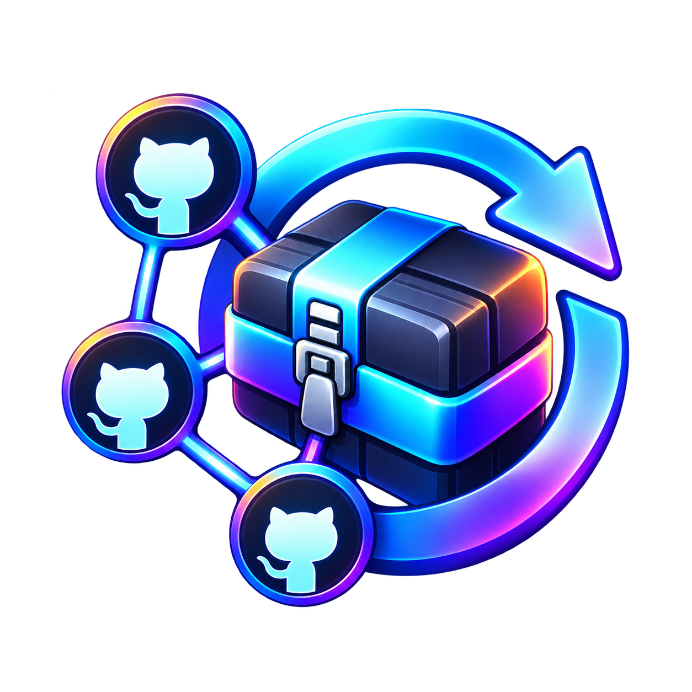

# GitHub Plugin Updater

**Decky plugin for SteamOS and Bazzite:** Stores followed GitHub repositories internally, checks releases, and automatically installs new plugins or newer versions.

**Language:** [Deutsch](README.md) · [English](README_EN.md)

## Features

- Stores followed repositories in Decky settings. On the first start after upgrading, entries from older versions are imported once.
- If a `repos.txt` exists in Downloads, you can import its links with a button. Already followed repositories are not duplicated.
- **Browse Decky Plugins** opens a searchable catalog of plugins, authors, tags and releases. **Add to Updater** saves a repository internally; existing entries show **Remove from Updater**.
- **Search GitHub** finds plugin names, `owner/repo`, or GitHub URLs beyond the curated catalog. Search results can be added to the followed list.
- **Other versions** lists published release ZIPs and changelogs. You can explicitly confirm an older version or prerelease. A manually selected older version is retained, pausing automatic updates for that repository until you choose **Follow latest version**.
- The collapsible **Installed plugins** list opens version selection for plugins with a known GitHub repository. If the plugin metadata lacks that link, the button opens GitHub search.
- Finds uploaded plugin ZIP assets in published GitHub releases. GitHub's auto-generated source archives are not used as plugin ZIPs.
- Installs plugins that are missing and replaces older installed versions; up-to-date versions are skipped.
- Matches installations by repository, plugin folder, and plugin name. For differing names, use **Followed repositories → Assign** in the UI to associate an existing installation manually.
- Shows compact Decky rows for status, repositories and the catalog, with a progress bar, current repository, step, elapsed time, and transferred data during downloads when available. Status rows show plugin names, version changes, and check results; the latest results remain visible after a Decky restart.
- Backs up the previous version, extracts updates into Decky's plugin directory, and restarts the Steam UI using Decky's own restart utility. With multiple approvals, this happens only once after every update has been approved or skipped.
- Also checks automatically about every 24 hours while Decky is running.
- Checks its own GitHub repository shortly after Decky starts and during regular checks, without requiring you to follow it.
- Runs long update checks in the background so progress remains available during slow GitHub downloads.
- In **Ask before installing** mode, a popup appears after the check for each pending update, showing the changelog and **Yes, install** / **No, skip this release**. Updates found during the scan also appear at the top of the plugin. Closing a popup or pressing B does not decline the update; you can reopen it later.

## Installation

1. Download and extract the supplied `github-plugin-updater-v1.9.2.zip`.
2. Copy its `github-plugin-updater` folder into `~/homebrew/plugins/`. For upgrades, replace the existing folder rather than creating another installation with a different name.
3. Restart Decky Loader or the device. Under **Settings → Repository storage**, you should see **Backend v1.9.2**.

If Decky is missing after a restart with an older updater version, run `sudo systemctl restart plugin_loader.service` in a terminal to restore Decky Loader, then install this update.

If the 12-second timeout occurs during a restart in version 1.6.7, install version 1.6.8 manually and restart Decky once. If the old restart failure is still shown, select **Try restart again**.

If version 1.6.0 or 1.6.1 reports “No response from the Decky backend after 12 seconds”, install this update manually and restart Decky. In 1.6.1, the backend may continue installing plugins despite that message. Check the results after restarting.

The plugin uses Decky's `root` flag because automatic installation requires write access to the plugin directory. Only follow GitHub repositories and release ZIPs you trust.

## Manage repositories

Open **Browse Decky Plugins** and select **Add to Updater** for plugins you want to follow. Under **Followed repositories**, you can remove individual entries or associate them with an installed Decky plugin. The list lives in Decky's plugin settings and survives restarts and updates. No Downloads file is needed for checks or installations.

**Optional file import:** If `repos.txt` exists in your configured XDG Downloads folder, `~/Downloads`, `/home/deck/Downloads`, or `/home/bazzite/Downloads`, an **Import repos.txt** button appears under **Followed repositories**. Press it to add valid GitHub links to the internal list. Comments and empty lines are ignored, duplicates skipped, and the file is left untouched. A message reports how many entries were added, already present, or invalid. If you create the file while the plugin view is open, reopen the view to reveal the button. Later file changes are imported only when you press it again.

**Upgrading from older versions:** On its first start, the plugin imports valid repository entries from the former Downloads text file into its internal list. Afterward, manage repositories in the plugin; later edits to the file are imported only when you press the import button.

## GitHub search and version selection

Use **Search GitHub** to search by plugin name or a specific `owner/repo`, then choose **Other versions** to browse release ZIPs. Searches and release lists load in the background so Decky stays responsive. If GitHub's API limit is exhausted, the version list attempts to use public release pages; the search shows an error and can be retried later.

Manual installation always shows a confirmation popup with the ZIP filename and changelog. Confirming installs the selected version and follows a newly installed repository internally. The previous installation is backed up. Selecting an older or otherwise nonlatest release pins it so the next automatic check does not immediately replace it. **Follow latest version** clears the pin. Self-updates still require a newer version.

## Browse Decky Plugins

Use the separate **Browse Decky Plugins** button just above **Followed repositories**. The browser uses its own Decky view with a Back button, so pressing Enter on the virtual keyboard does not close the browser. Search by name, author, repository, description or tag. Sort by stars, downloads, release date or name using the buttons on the page; **Filter by tag** expands a list of popular tags. These controls stay within the browser view. The catalog loads the [plugin list from Safet Zahirovic's Decky Plugin Explorer](https://safetzahirovic.github.io/decky-plugins-explorer/) in the background, so a slow network request does not block the Decky backend. Use **Refresh** to load a newer catalog.

**Add to Updater** saves the repository to the internal list. If it is already followed, the button reads **Remove from Updater**. You can also remove it under **Followed repositories**. This stops following the repo but does not uninstall the plugin. Changes take effect immediately and persist after a restart. New entries are considered on the next check according to your installation mode.

The Explorer is an independent, automatically maintained GitHub index; its entries have not been vetted for security. A catalog entry does not guarantee a compatible release ZIP. Review source code and follow only repositories you trust.

## Check for updates

1. In Decky, select **GitHub Updates → Check for updates**.
2. Follow the current repository, step, and progress. The percentage may pause while GitHub responds; elapsed time keeps running.
3. View the results and any error messages in the plugin. The Steam UI briefly restarts after successful installations.

A release ZIP must contain a built Decky plugin with `plugin.json`, `package.json`, `main.py`, and `dist/index.js`. Its display name may differ from the GitHub repository name. Versions, archive sizes, and archive paths are checked before installation. Old installations are stored under `~/homebrew/data/github-plugin-updater/backups/`; downloaded ZIPs go to `~/Downloads`.

When the GitHub API rate limit is reached, the plugin tries the public releases page. After a Python TLS handshake error, it can also retry with system `curl` while still verifying certificates. Real network failures and denied downloads can still prevent updates.

## Language and confirmation mode

The interface follows your Steam language setting: German, English, Spanish, French, or Russian. **Settings → Language** shows the selected language. If Steam uses another language or its language cannot be read, the plugin uses English. Changes to the Steam language are reflected while the plugin is open.

Under **Settings → Installation mode**, switch **On** for automatic installation or **Off** to ask before installing. In confirmation mode the plugin still checks releases but waits for approval before downloading and installing **other plugins**. After the scan, a popup shows the **changelog** (GitHub release notes) for each pending update with **Yes, install** and **No, skip this release** buttons. When a release has no notes, the interface says so. A declined release stays skipped on subsequent scheduled checks; a newer release is offered again. Pending approvals survive a Decky restart and are also shown at the top of the plugin. Only clicking **Yes** or **No** records a decision. Pressing B closes the popup without declining; **Open next approval popup** lets you return to it. An unexpectedly closed popup will not trigger a series of new popups. Each decision is followed by the next prompt. Once you have answered them all, the Steam UI restarts once, provided at least one update was installed. Declining every update needs no restart. A new scan waits until all pending approvals are resolved. **The updater's own newer releases are installed automatically.**

## Self-updates

The plugin checks `https://github.com/Steamdeckchecker/Github-Decky-Plugins-Updater` about 20 seconds after Decky starts and during each regular update check. You do not need to add that repository. After a recent check, startup checks are throttled for at least five minutes. Newer versions are installed automatically even in **Ask before installing** mode. Only built ZIPs with the correct plugin identity, package name, and a newer version are accepted; the previous installation is backed up. The existing Decky Steam UI restart path waits for the scan and any pending decisions about other plugins to finish.

From version 1.6.8, the frontend invokes Decky's own Steam UI restart utility once the installation and approvals have finished. The plugin RPC completes before Steam is restarted; Decky Loader itself is not stopped. If the utility reports an error or the UI is still present eight seconds later, the plugin offers **Try restart again**. You can still check for updates after a restart failure.

Self-updates require built plugin ZIPs published as release assets in that public repository; GitHub's generated source archives are not installed.

## Development

Run `pnpm install` and `pnpm run build` in the source directory to produce `dist/index.js`. The installable ZIP must already contain this file; Node.js is not needed on the Steam Deck.
